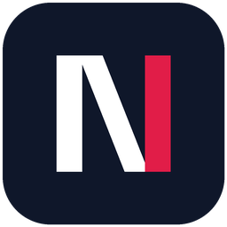
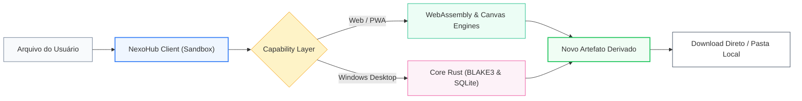

<p align="center">
  
</p>

# <p align="center">NexoHub</p>

<p align="center">
  <strong>Estação documental local-first, gratuita e privativa para PDFs e documentos.</strong><br />
  <em>A agilidade ergonômica de manipulação no estilo iLovePDF combinada com a segurança inegociável do processamento 100% no seu dispositivo.</em>
</p>

<p align="center">
  <a href="https://github.com/junior-aguiar-eng/NexoHub/actions/workflows/main.yml">
    
  </a>
  <a href="https://github.com/junior-aguiar-eng/NexoHub/actions/workflows/ci.yml">
    
  </a>
  <a href="https://github.com/junior-aguiar-eng/NexoHub/actions/workflows/security.yml">
    
  </a>
  <a href="LICENSE">
    
  </a>
  
  
  
</p>

---

### 🚀 Acesso Imediato na Web

Sem cadastro, sem filas e sem limites artificiais de páginas:

<p align="center">
  <a href="https://nexohub.nexojuris.ia.br">
    
  </a>
</p>

> [!NOTE]
> **Privacidade Absoluta:** No navegador, toda a execução corre diretamente na memória via **WebAssembly / JavaScript local**. Nenhum documento ou imagem é enviado a servidores remotos ou exposto na nuvem.

---

## 🎯 Por que o NexoHub?

| Pilar | Como Entregamos |
|---|---|
| 🛡️ **Privacidade por Design** | Processamento 100% offline no dispositivo host. Zero telemetria invasiva, sem rastreadores. |
| 💸 **Livre e Gratuito** | Código aberto (MPL-2.0). Sem planos pagos, assinaturas, paywalls ou filas artificiais. |
| 🔒 **Imutabilidade Estrita** | O documento original importado jamais é sobrescrito; toda transformação produz um novo artefato derivado. |
| ⚡ **Design Contemporâneo** | Interface minimalista com parallax dinâmico suave, atalhos rápidos de teclado (`Ctrl + K`) e foco operacional. |
| 💻 **Paridade Web & Desktop** | O mesmo catálogo de 34 ferramentas operacionais ativas tanto no client Web quanto no aplicativo Windows nativo. |

---

## 🛠️ Catálogo de Ferramentas Ativas (34 Ferramentas)

Todas as ferramentas abaixo possuem **executores reais e funcionais** na Web e no Desktop Windows x64.

<details open>
<summary><strong>📁 1. Organizar PDF (6 ferramentas)</strong></summary>

| Ferramenta | Descrição Operacional | Motor de Execução |
|---|---|---|
| **Organizar PDF** | Reordenar, rotacionar e remover páginas com miniaturas visuais | `pdf-lib` / Core Rust |
| **Juntar PDF** | Mesclar múltiplos arquivos em uma saída consolidada | `pdf-lib` / Core Rust |
| **Dividir PDF** | Extrair páginas individuais ou intervalos (`start-end`) em PDF único ou ZIP | `pdf-lib` / Core Rust |
| **Remover Páginas** | Excluir páginas selecionadas preservando o restante intacto | `pdf-lib` (Client-side) |
| **Extrair Páginas** | Separar páginas de interesse em novo documento ou arquivos independentes | `pdf-lib` (Client-side) |
| **Digitalizar para PDF** | Capturar imagens da câmera ou mesa digitalizadora e compilar em PDF | Canvas / `pdf-lib` |

</details>

<details open>
<summary><strong>⚡ 2. Otimizar PDF (2 ferramentas)</strong></summary>

| Ferramenta | Descrição Operacional | Motor de Execução |
|---|---|---|
| **Comprimir PDF** | Compactação estrutural e reencodagem de imagens em 3 níveis reais | `pdf-lib` / Rust BLAKE3 |
| **OCR em PDF** | Reconhecimento óptico de caracteres offline gerando PDF pesquisável e TXT | Tesseract.js / RapidOCR |

</details>

<details open>
<summary><strong>🔄 3. Converter em PDF & de PDF (5 ferramentas)</strong></summary>

| Ferramenta | Descrição Operacional | Motor de Execução |
|---|---|---|
| **Imagem para PDF** | Converter e compilar JPG, PNG e WebP com orientação e margens | `pdf-lib` (Client-side) |
| **HTML para PDF** | Converter código ou página HTML semântica com layout preservado | Web Renderer / PDF |
| **PDF para JPG** | Exportar páginas em alta definição (150 DPI) com download direto ou em ZIP | PDF.js + ZIP em memória |
| **PDF para Excel** | Extração posicional tabular para planilha OpenXML (`.xlsx`) ou `.csv` | PDF.js + Excel Engine |
| **Extrair Imagens** | Identificar e salvar recursos gráficos (`XObject`) em PNG/JPG nativo | PDF.js / `pdf-lib` |

</details>

<details open>
<summary><strong>✏️ 4. Editar PDF (6 ferramentas)</strong></summary>

| Ferramenta | Descrição Operacional | Motor de Execução |
|---|---|---|
| **Rotacionar PDF** | Girar páginas em ângulos retos de 90°, 180° ou 270° | `pdf-lib` / Core Rust |
| **Recortar PDF** | Ajustar margens visuais (`CropBox`) sem rasterizar vetores ou texto | `pdf-lib` (Client-side) |
| **Editar PDF** | Modificar blocos de texto e adicionar anotações/formas vetoriais | WASM local / PDF.js |
| **Números de Página** | Numeração tipográfica configurável em cabeçalho ou rodapé | `pdf-lib` (Client-side) |
| **Marca d'água** | Inserir carimbo de texto com controle de opacidade, ângulo e cor | `pdf-lib` (Client-side) |
| **Preencher Formulário** | Editar campos interativos AcroForm e achatá-los opcionalmente | `pdf-lib` (Client-side) |

</details>

<details open>
<summary><strong>🛡️ 5. Segurança do PDF (5 ferramentas)</strong></summary>

| Ferramenta | Descrição Operacional | Motor de Execução |
|---|---|---|
| **Desbloquear PDF** | Descriptografar PDF (RC4/AES) com a senha de abertura conhecida | PDF.js Crypto Engine |
| **Proteger PDF** | Criptografar documento com senha de leitura e controle de permissões | `@pdfsmaller/pdf-encrypt` |
| **Assinar PDF** | Aplicar assinatura visual/rubrica via desenho, digitação ou imagem | Canvas / `pdf-lib` |
| **Ocultar PDF (Tarja)** | Aplicar tarjas opacas irreversíveis sobre coordenadas confidenciais | `pdf-lib` (Client-side) |
| **Comparar PDF** | Análise comparativa visual e estrutural com emissão de relatório PDF | Web Worker Comparison |

</details>

<details open>
<summary><strong>🧠 6. PDF Intelligence & Texto (4 ferramentas)</strong></summary>

| Ferramenta | Descrição Operacional | Motor de Execução |
|---|---|---|
| **PDF para Markdown** | Extrair texto estruturado com títulos, listas e tabelas heurísticas | PDF.js Parser |
| **Traduzir Documento** | Tradução neural multilíngue offline via modelo local em sandbox | Transformers.js (NLLB) |
| **Comparar Textos** | Diff semântico e estrutural de textos com estatísticas de adições/remoções | Diff Engine TypeScript |
| **Revisar Texto** | Correção gramatical e morfológica contextual em português | Hunspell / LanguageTool |

</details>

<details open>
<summary><strong>🖼️ 7. Modo Imagem (6 ferramentas)</strong></summary>

| Ferramenta | Descrição Operacional | Motor de Execução |
|---|---|---|
| **Comprimir Imagem** | Otimizar imagens JPG, PNG e WebP com compressão configurável | Canvas Engine local |
| **Redimensionar Imagem** | Alterar dimensões por porcentagem ou pixels com trava de aspecto | Canvas Engine local |
| **Recortar Imagem** | Corte retangular preciso com coordenadas visuais | Canvas Engine local |
| **Converter Imagem** | Transcodificar formatos gráficos entre JPG, PNG e WebP | Canvas Engine local |
| **Girar Imagem** | Rotações de 90°, 180°, 270° e espelhamento horizontal/vertical | Canvas Engine local |
| **Marca d'água em Imagem** | Sobrepor texto ou logotipo sobre fotos e ilustrações | Canvas Engine local |

</details>

> 📖 **Consulte o [Catálogo Canônico de Ferramentas](docs/CATALOGO-FERRAMENTAS.md)** para o inventário completo, limites operacionais e roadmap das ferramentas planejadas (Reparar PDF, Conversores Office e IA Local).

---

## 🏗️ Arquitetura do Sistema

O NexoHub é construído como um monorepo modular e estritamente desacoplado:

```text
NexoHub/
├── apps/
│   ├── client/              # Frontend React 19 + TypeScript + Vite + Design System
│   └── desktop/             # Invólucro nativo Windows x64 com Tauri v2 e WebView2
├── crates/                  # Módulos de computação e persistência em Rust
│   ├── nexohub-core/        # Motor central: blobs BLAKE3, SQLite, linhagem e auditoria
│   ├── nexohub-cli/         # Interface de linha de comando com comandos determinísticos
│   └── nexohub-server/      # Servidor HTTP seguro para validação e testes
├── packages/                # Pacotes TypeScript compartilhados
│   ├── domain/              # Tipos canônicos, contratos de dados e i18n (pt-BR)
│   ├── contracts/           # Interfaces de portas (Platform & Capability Ports)
│   ├── tool-sdk/            # SDK para criação e execução segura de ferramentas
│   └── tool-registry/       # Registro central e metadados oficiais de ferramentas
├── engines/                 # Motores especializados externos
│   └── python/              # Sidecar Python (OCR, NLP e tradução) gerenciado via uv
└── docs/                    # Especificações, catálogo de ferramentas e ADRs
```

### 🔒 Fluxo de Dados Local-First



---

## 💻 Instalação e Desenvolvimento Local

### Pré-requisitos
* **Node.js**: `24.x` (LTS)
* **pnpm**: `11.x`
* **Rust**: `1.88+` (com target `x86_64-pc-windows-msvc` no Windows)
* **uv / Python**: [Astral uv](https://docs.astral.sh/uv/) instalado
* **WebView2**: Runtime do Windows (padrão no Windows 10/11)

### Passo a Passo

```powershell
# 1. Clonar o repositório
git clone https://github.com/junior-aguiar-eng/NexoHub.git
cd NexoHub

# 2. Instalar dependências congeladas
pnpm install --frozen-lockfile

# 3. Sincronizar o sidecar Python
uv sync --locked --project engines/python

# 4. Iniciar em modo de desenvolvimento
pnpm dev:web        # Para executar a versão Web
pnpm dev:desktop    # Para executar a versão Desktop nativa (Tauri)
```

---

## 🧪 Qualidade e Gates de Verificação

O projeto mantém **tolerância zero** para quebras de contrato, falhas de tipo ou regressões visuais:

```powershell
# Verificação estrita de linter e formatação (Biome) + Typecheck (TypeScript)
pnpm check

# Testes unitários de todos os workspaces (Vitest)
pnpm test

# Testes ponta a ponta reais no Chromium (Playwright E2E)
pnpm test:e2e:ci

# Build de produção do client web
pnpm build:web

# Verificação e testes do Core nativo (Rust)
cargo fmt --all --check
cargo clippy --workspace --all-targets --locked -- -D warnings
cargo test --workspace --locked

# Auditoria rigorosa de licenças de dependências (MPL-2.0, MIT, Apache-2.0, BSD)
pnpm licenses:check
```

---

## 📚 Documentação do Projeto

| Documento | Descrição |
|---|---|
| 📋 [**Catálogo Canônico de Ferramentas**](docs/CATALOGO-FERRAMENTAS.md) | Inventário oficial das 34 ferramentas ativas, motores e pendências. |
| 🗺️ [**Roadmap de Engenharia**](docs/ROADMAP.md) | Fases de desenvolvimento concluídas e roadmap das Fases 17 a 20. |
| 📐 [**Arquitetura do Sistema**](docs/ARCHITECTURE.md) | Visão técnica, fluxo de dados, contratos de portas e sidecars. |
| 🎨 [**Design System**](docs/DESIGN-SYSTEM.md) | Tokens tipográficos, paleta de cores, ergonomia e micro-interações. |
| 📦 [**Definition of Done**](docs/DEFINITION-OF-DONE.md) | Critérios estritos de aceite para cada entrega de código. |
| 🔐 [**Hardening e Segurança**](docs/HARDENING.md) | Mitigação de vulnerabilidades, limites de memória e sandboxing. |
| 🛡️ [**Política de Privacidade**](docs/PRIVACY.md) | Diretrizes e garantias do modelo local-first sem envio externo. |
| 📜 [**Decisões de Arquitetura (ADRs)**](docs/adr/) | Registro histórico de decisões arquiteturais do projeto. |

---

## 📄 Licença

Distribuído sob a licença **MPL-2.0** (Mozilla Public License 2.0). Consulte o arquivo [LICENSE](LICENSE) para mais detalhes.
