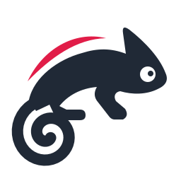

<p align="center">
  <picture>
    <source media="(prefers-color-scheme: dark)" srcset="docs/branding/camaleao-b/nexohub-camaleao-b-reverso.svg" />
    
  </picture>
</p>

# NexoHub

Estação documental gratuita e local-first para PDFs, textos e imagens, com aplicativo Windows e versão web. Os arquivos são processados no dispositivo; os recursos de OCR, tradução e revisão podem precisar de downloads iniciais.

[](https://github.com/junior-aguiar-eng/NexoHub/actions/workflows/ci.yml)
[](https://github.com/junior-aguiar-eng/NexoHub/actions/workflows/security.yml)
[](LICENSE)

> **Estado**: `0.2.4` em preparação — a versão Windows publicada e validada é a `0.2.3`. Os limites de cada ferramenta permanecem documentados.

## Usar o NexoHub

- **Web:** [abrir em nexojuris.ia.br/hub/](https://nexojuris.ia.br/hub/).
- **Windows x64:** [baixar o instalador da versão 0.2.3](https://github.com/junior-aguiar-eng/NexoHub/releases/download/v0.2.3/NexoHub_0.2.3_x64-setup.exe).
- **Releases:** [versão mais recente e arquivos de validação](https://github.com/junior-aguiar-eng/NexoHub/releases/latest).

Para usar o aplicativo instalado, não é necessário instalar Node.js, Rust ou Python. O instalador verifica o requisito WebView2. LanguageTool e Java são componentes **opcionais**, baixados separadamente quando escolhidos para a revisão textual local no Windows. O instalador atual não possui assinatura Authenticode.

A release inclui `SHA256SUMS.txt`, o instalador, um ZIP com o build web e o pacote do engine Python, e `VALIDACAO-WINDOWS-0.2.3.json`. O ZIP portátil não é uma distribuição autônoma do aplicativo Windows. Instalação limpa, abertura, atualização da 0.2.2, preservação de documento e desinstalação foram verificadas em Sandbox; a instalação deste ambiente também foi atualizada para 0.2.3. Veja a [validação da release](docs/RELEASE-VALIDATION.md).

## O que mudou na 0.2.3

- **Nomes a preservar:** informe um nome por linha antes de traduzir. As correspondências são copiadas literalmente, respeitando maiúsculas, acentos e espaços.
- **Cache do tradutor validado:** depois da primeira carga, a tradução foi repetida após fechar e reabrir o aplicativo, inclusive com WebView2 offline, sem requisitar novamente o modelo.
- **Mais verificações de exportação Windows:** PNG, JPG e XLSX foram gravados pelo diálogo nativo e reabertos; os resultados e limites estão documentados.

Detalhes no [changelog](CHANGELOG.md). A preservação dos nomes usa trechos menores de tradução e pode afetar capitalização e fluidez ao redor deles. O resultado deve ser revisado.

## Catálogo: 36 ferramentas implementadas

São 30 ferramentas de PDF/texto e seis de imagem. A interface e o catálogo são compartilhados entre web e Windows; os motores, dependências e limites de validação variam por ferramenta e plataforma. A tabela abaixo segue os agrupamentos atuais da interface.

| Grupo | Ferramentas |
| --- | --- |
| Organizar PDF (8) | Organizar, juntar, dividir, rotacionar, recortar, numerar, remover e extrair páginas |
| Editar e comparar PDF (3) | Editar conteúdo compatível, comparar documentos e preencher formulários |
| Otimizar PDF (2) | Comprimir e reparar PDF |
| Converter PDF (8) | Imagem para PDF, PDF para JPG, extrair imagens, PDF para Markdown, PDF para Excel, PDF para Word, HTML para PDF e digitalizar para PDF |
| Texto e OCR (4) | OCR, comparar textos, revisar texto e traduzir texto |
| Segurança (5) | Marca d’água, proteger, ocultar conteúdo, assinatura visual e desbloquear com senha conhecida |
| Imagem (6) | Comprimir, redimensionar, recortar, converter, girar e aplicar marca d’água |

O [catálogo canônico](docs/CATALOGO-FERRAMENTAS.md) descreve executores e limitações. O índice de qualidade cobre **35 perfis restritos**; PDF para Word integra o catálogo, mas está explicitamente fora desse recorte Q-C0. Isso não equivale a homologação integral de todas as ferramentas para qualquer documento.

## Processamento local e recursos iniciais

- **Tradução:** o fluxo compartilhado usa M2M100 q8 em worker, com português, inglês e espanhol. Os pesos somam cerca de 603 MiB, além do runtime e tokenizer. O primeiro uso precisa de rede. Cache apagado, troca de perfil, falta de espaço ou mudança do modelo podem exigir novo download. [Modelo, licença e limites](docs/TRADUCAO-WEB.md).
- **OCR:** Tesseract.js é usado no fluxo browser, inclusive no Windows. Recursos de idioma e runtime podem ser baixados no primeiro uso. A leitura da fotografia de livro investigada continua reprovada; filtros, recorte e ampliação não demonstraram uma correção adequada. [Investigação](docs/INVESTIGACAO-OCR-TRADUCAO-2026-10-29.md).
- **Revisão:** o navegador usa Hunspell e regras locais; o Windows pode usar LanguageTool/Java opcionais. Os motores têm capacidades diferentes. [Distribuição do runtime](docs/adr/ADR-019-distribuicao-runtime-languagetool.md).
- **Privacidade:** documentos e textos são processados localmente nos fluxos padrão. Os downloads de recursos usam servidores dos fornecedores; não representam envio do documento para processamento. [Política técnica](docs/PRIVACY.md).

A tradução de uma amostra foi revisada pelo usuário em 30 comparações; isso não garante fidelidade para outros documentos. Interrupções intermitentes no download do modelo continuam sob investigação. Editar PDF, reparo, conversões e tarjas também têm perfis e recusas próprios. Assinar PDF aplica uma rubrica visual; não substitui assinatura digital com certificado.

## Arquitetura

Monorepo com client React/TypeScript compartilhado, shell Windows Tauri v2/WebView2, core Rust e sidecars locais acessados por portas de capacidade. A UI não acessa diretamente filesystem, SQLite ou shell. Os originais importados permanecem imutáveis; as operações produzem artefatos derivados.

```text
apps/client/              React, TypeScript e Vite; web e interface do desktop
apps/desktop/src-tauri/   Shell Windows, IPC e integração nativa
crates/nexohub-core/      Document Core, blobs, SQLite e operações locais
crates/nexohub-server/    Servidor HTTP opcional
packages/                domain, contracts, tool-sdk e tool-registry
engines/python/          Engine local com protocolo JSON Lines por stdin/stdout
docs/                    Produto, arquitetura, ADRs, qualidade e release
```

O servidor HTTP não é necessário para o processamento padrão das ferramentas. A tradução nativa CTranslate2 é um caminho separado do M2M100 usado pela tela atual. Consulte a [arquitetura](docs/ARCHITECTURE.md).

## Desenvolvimento local

Requisitos: Node.js 22 (usado na CI) ou 24 (ambiente local validado), **pnpm 11.19.0**, Rust stable e uv. O manifesto declara Rust 1.88 como mínimo; a CI usa o toolchain stable. Para compilar o desktop Windows, são necessários o target MSVC, as ferramentas de compilação e WebView2. O instalador é gerado com Inno Setup pelo script do projeto.

```powershell
git clone https://github.com/junior-aguiar-eng/NexoHub.git
cd NexoHub
pnpm install --frozen-lockfile
uv sync --locked --project engines/python

pnpm dev:web
# Ou, no Windows:
pnpm dev:desktop
```

## Verificações

```powershell
pnpm check
pnpm test
pnpm quality:check
pnpm build:web
pnpm --filter @nexohub/client install:e2e
pnpm test:e2e:ci

cargo fmt --all --check
cargo clippy --workspace --all-targets --locked -- -D warnings
cargo test --workspace --locked

pnpm licenses:check
pnpm release:verify
```

Os workflows da [CI](.github/workflows/ci.yml), de [segurança](.github/workflows/security.yml) e de [release](.github/workflows/release.yml) executam seus respectivos gates. O [deploy web](.github/workflows/deploy-cloudrun.yml) publica em `/hub/` após a CI de `main`; tag, release Windows e instalação são etapas distintas.

## Documentação

| Documento | Conteúdo |
| --- | --- |
| [Produto](docs/PRODUCT.md) | Plataformas, experiência e escopo |
| [Catálogo](docs/CATALOGO-FERRAMENTAS.md) | Inventário e limitações por ferramenta |
| [Roadmap](docs/ROADMAP.md) | Entregas e pendências |
| [Arquitetura](docs/ARCHITECTURE.md) | Portas, domínio, executores e sidecars |
| [Qualidade](docs/quality/README.md) | Perfis de evidência e limites do Q-C0 |
| [Tradução](docs/TRADUCAO-WEB.md) | Modelo, nomes preservados, downloads e cache |
| [Validação de release](docs/RELEASE-VALIDATION.md) | Estado atual e evidências históricas |
| [Checklist de release](docs/RELEASE-CHECKLIST.md) | Verificações exigidas antes de publicar |
| [Deploy web](docs/DEPLOY-HUB.md) | Base `/hub/`, destino e conferência pública |
| [Privacidade](docs/PRIVACY.md) | Processamento local, rede e logs |
| [Design system](docs/DESIGN-SYSTEM.md) | Identidade visual e componentes |
| [ADRs](docs/adr/) | Decisões arquiteturais |

## Licença

[MPL-2.0](LICENSE). Dependências, recursos e modelos mantêm suas próprias licenças e atribuições; consulte [THIRD_PARTY_LICENSES.md](THIRD_PARTY_LICENSES.md) e os relatórios específicos de cada motor.
