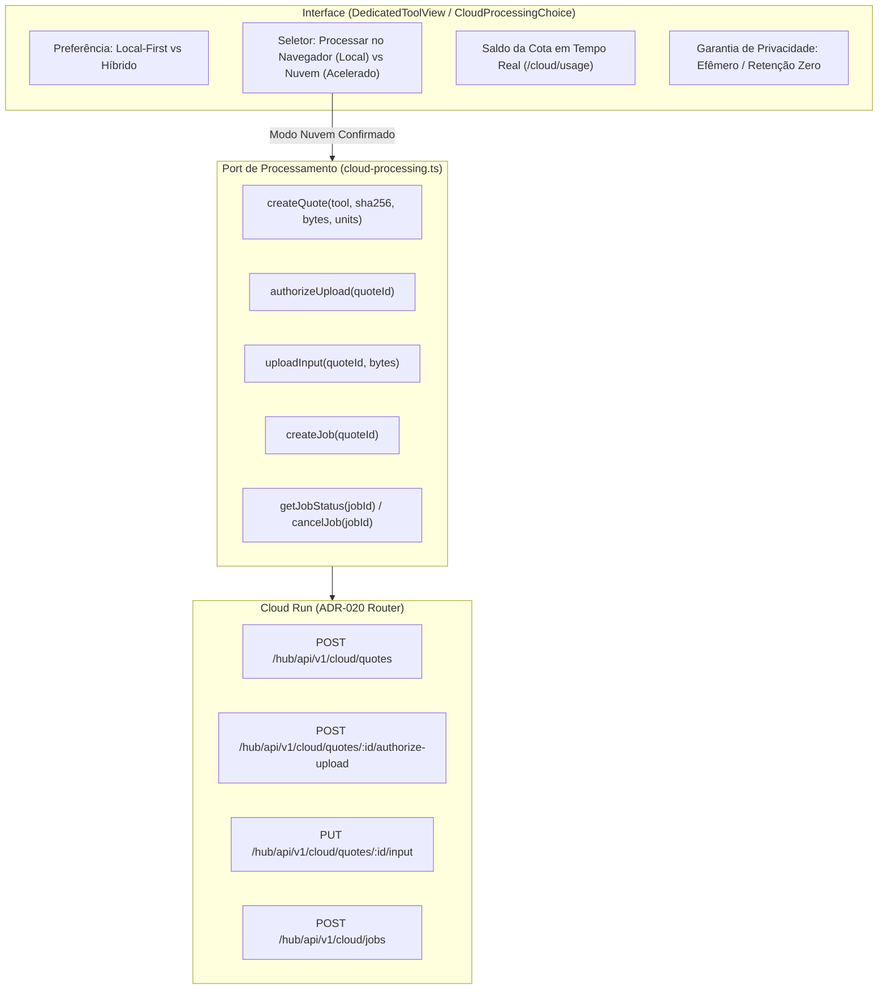

# Plano de Implementação — Frente C: Ponte de Execução em Nuvem Híbrida (ADR-020)

> **Objetivo:** Conectar a interface do NexoHub ao backend híbrido do ADR-020, permitindo que ferramentas pesadas (`pdf-ocr`, `text-translate`) ofereçam a opção de aceleração na nuvem sob cotas gratuitas mensais, preservando estritamente o princípio *local-first*, consentimento prévio e fallback gracioso sem perda de dados.

---

## 1. Arquitetura da Solução

---

## 2. Tarefas de Implementação

### Task 1: Platform Port de Processamento Remoto (`cloud-processing.ts`)
- [ ] Criar tipos e interface `CloudProcessingPort` em `apps/client/src/platform/cloud-processing.ts`:
  - `createQuote(req: CloudQuoteRequest): Promise<CloudQuote>`
  - `authorizeUpload(quoteId: string): Promise<boolean>`
  - `uploadInput(quoteId: string, data: Uint8Array): Promise<boolean>`
  - `createJob(quoteId: string): Promise<CloudJob>`
  - `getJobStatus(jobId: string): Promise<CloudJob>`
  - `cancelJob(jobId: string): Promise<CloudJob>`
- [ ] Implementar `createCloudProcessing` com suporte a autenticação via Bearer token de `CloudIdentityPort`, cálculo de SHA-256 no browser via `crypto.subtle.digest`, tratamento de códigos de erro estruturados (`QUOTA_EXCEEDED`, `AUTH_REQUIRED`, etc.).
- [ ] Implementar `createDisabledCloudProcessing()` para ambientes sem nuvem.
- [ ] Escrever suíte de testes unitários em `apps/client/src/platform/cloud-processing.test.ts`.

### Task 2: Componente Tátil de Escolha e Consentimento (`CloudProcessingChoice.tsx`)
- [ ] Criar `apps/client/src/features/launcher/CloudProcessingChoice.tsx`:
  - Renderizar opções táteis: "Processar no Navegador (Local)" vs "Processar na Nuvem (Acelerado)".
  - Exibir badge com cota disponível para a ferramenta selecionada (obtida via `account.usage()`).
  - Se desconectado: exibir callout informativo com link para entrar na conta e liberar cotas.
  - Exibir nota de privacidade do ADR-020: *"Seus arquivos são processados em memória volátil e descartados imediatamente."*
- [ ] Adicionar suporte a acessibilidade (role="radiogroup", navegação por teclado, labels descritivos).
- [ ] Escrever suíte de testes unitários em `apps/client/src/features/launcher/CloudProcessingChoice.test.tsx`.

### Task 3: Chaves de Internacionalização (`pt-BR.ts`) e Estilização (`styles.css`)
- [ ] Adicionar catálogo de chaves `cloudProcessing.*` no arquivo canônico `apps/client/src/i18n/pt-BR.ts`.
- [ ] Adicionar classes de estilo `.cloud-choice-*` em `apps/client/src/styles.css` harmonizadas com o design system do NexoHub.

### Task 4: Integração no Painel da Ferramenta (`DedicatedToolView.tsx`)
- [ ] Exibir `CloudProcessingChoice` nas ferramentas elegíveis (`pdf-ocr` e `text-translate`).
- [ ] Sincronizar escolha com a preferência salva pelo usuário (`getProcessingPreference()`).
- [ ] No acionamento de processamento:
  - Se modo `local`: prosseguir com o motor WASM existente (Tesseract / Transformers.js).
  - Se modo `cloud`: solicitar cotação, autorizar, enviar arquivo e acompanhar job com feedback textual e barra de progresso.
  - Em caso de falha de cota ou conexão na nuvem: sugerir e permitir fallback automático para o motor local sem perder o arquivo.

### Task 5: Validação Global e Testes
- [ ] Executar `pnpm lint` (`biome check .`)
- [ ] Executar `pnpm typecheck`
- [ ] Executar testes Vitest direcionados e de regressão
- [ ] Executar `pnpm build:web`
